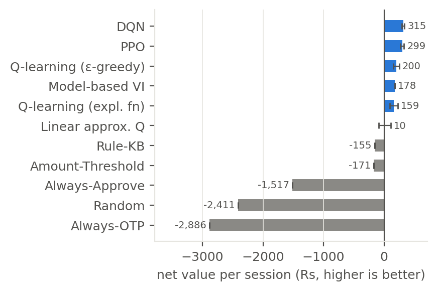
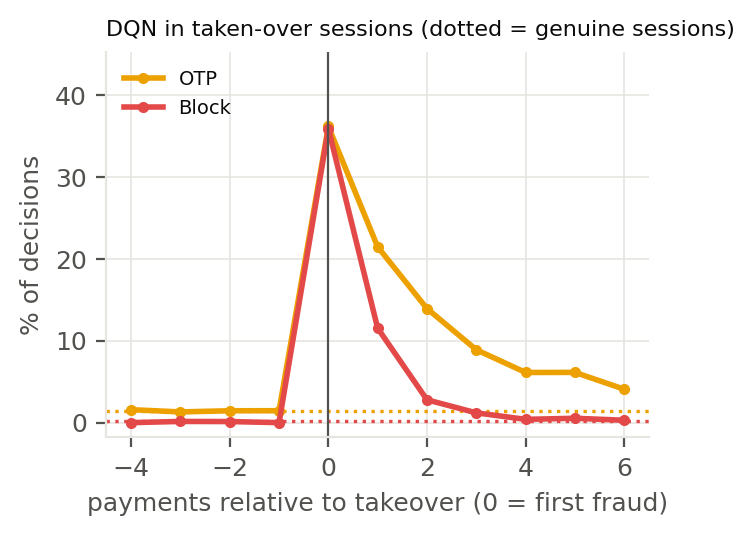

# FrictionRL — learning when to ask for an OTP

**CSL3090 Artificial Intelligence (IIT Jodhpur) · Assignment 2: Real-Life Use Cases of RL**
Team: Tanisha Ray (B24CM1061), Cherry Aggarwal (B24CM1016)

**Live demo:** <https://codertanisha22.github.io/FrictionRL/> — the trained DQN agent runs in your browser on new
sessions, next to the rule base, plus a "what would the agent do?" panel.

Every UPI or card payment gets one of three decisions: **approve**, **step-up (OTP)**, or **block**.
Static rules either let fraudsters drain accounts or bury genuine users in OTPs until they leave the app.
FrictionRL treats each user session as a **Markov Decision Process** and trains RL agents to trade fraud
loss against friction and churn — in rupees.

Why this needs RL and not a classifier:
* **Friction compounds:** every OTP raises the chance the next one makes a genuine user quit.
* **Acting early pays later:** stopping a fraudster now prevents all of their next transactions.
* **Actions reveal information:** a failed OTP is strong evidence of account takeover.
* **The attacker adapts:** a blocked fraudster retries with a smaller amount.

## Results (5,000 held-out sessions, mean ± std over 3 training seeds)

| Agent | Net Rs / session ↑ | Fraud loss Rs / session ↓ | Churn % ↓ | OTPs / session |
|---|---|---|---|---|
| Always-Approve | −1,517 | 2,116 | 0.0 | 0.0 |
| Always-OTP | −2,886 | 40 | 100.0 | 6.7 |
| Random | −2,411 | 86 | 57.2 | 1.7 |
| Amount threshold | −171 | 457 | 6.7 | 1.0 |
| Rule base (propositional) | −155 | 475 | 5.6 | 0.5 |
| Model-based value iteration | 178 | 373 | 1.4 | 0.4 |
| Tabular Q-learning (ε-greedy) | 200 ± 49 | 220 | 5.0 | 1.4 |
| Tabular Q-learning (exploration fn) | 159 ± 65 | 200 | 6.3 | 1.4 |
| Linear approximate Q | 10 ± 97 | 504 | 2.5 | 1.2 |
| **DQN** | **315 ± 21** | 238 | 1.4 | 0.4 |
| **PPO** | **299 ± 30** | 273 | **0.9** | 0.5 |

* DQN and PPO earn about Rs 470 more per session than the best rule base, halve fraud loss and cut churn from 5.6% to about 1%.
* Value iteration (226 sweeps) and policy iteration (5 improvement steps) give the identical policy.
* Tabular Q-learning on the learned (exactly Markov) model matches value iteration on 99.1% of decisions; on the
  simulator 95.2%. The gap is the hidden fraudster.
* Full table with false-block and fraud-completion rates: [`results/results_table.md`](results/results_table.md).


 

## The MDP

| | Definition |
|---|---|
| **Episode** | one user session, up to H = 20 transactions. With p = 0.15 the account is taken over at a random step (hidden from the agent); the fraudster cashes out or gives up later |
| **State S** | 11-dim vector: amount vs. user's usual (log-ratio), new device, new payee, odd hour, burst, session risk rate, progress t/H, #OTPs issued, OTP-failed seen, OTP-passed seen, #blocks. Discrete version (432 states) for tabular methods |
| **Actions A** | Discrete(3): APPROVE, OTP step-up, BLOCK |
| **Reward R** (Rs) | +2% of a completed genuine payment; −(amount + Rs 200 chargeback) for completed fraud; −Rs 2 per OTP; −Rs 50 per false block; −Rs 3000 (lifetime value) if the genuine user churns; −Rs 1500 if a genuine account is frozen |
| **Dynamics T** | genuine OTP pass 97%; churn after OTP = 1% + 4%·(#previous OTPs); churn after false block = 20% + 20%·(#previous blocks); fraudster beats OTP 15%; after a failed OTP the fraudster quits 70%; after a block it retries at half the amount 50%; 2nd block freezes the account (terminal) |
| **γ** | 0.99 |

All constants live in [`frictionrl/config.py`](frictionrl/config.py).

## Algorithms (one per lecture)

| Method | Lecture | File |
|---|---|---|
| Baselines: always-approve / always-OTP / random / amount threshold / propositional rule base | Lec 16 | `baselines.py` |
| Model-based learning (count T̂, R̂) + **value iteration** + **policy iteration** | Lec 27–28 | `planning.py` |
| **Tabular Q-learning**: ε-greedy and exploration function f(u,n) = u + k/(n+1) | Lec 28–29 | `qlearning.py` |
| **Approximate Q-learning** with linear features (interpretable weights) | Lec 29 | `qlearning.py` |
| **DQN** (experience replay + target network) and **PPO** (actor–critic, GAE, clipped objective) | Lec 29 | `train_sb3.py` |

Tabular methods, VI/PI and linear Q are written from scratch with NumPy; DQN and PPO use Stable-Baselines3.

## Installation

Requires Python 3.10 or newer (tested with Python 3.10). A CPU is enough; no GPU is needed.

```bash
git clone https://github.com/coderTanisha22/FrictionRL.git
cd FrictionRL
python3 -m venv .venv
source .venv/bin/activate              # Windows: .venv\Scripts\activate
pip install -r requirements.txt        # numpy, pandas, matplotlib, gymnasium, stable-baselines3, torch, pytest
```

To keep the download small on a machine without a GPU, install the CPU build of PyTorch first:
`pip install torch --index-url https://download.pytorch.org/whl/cpu`, then `pip install -r requirements.txt`.

Check the installation:

```bash
python -m pytest -q                    # 8 tests, about 5 seconds
```

## Run the trained agent

The trained agents are committed in [`results/models/`](results/models/), so this works straight after installing:

```bash
python scripts/demo_session.py --agent dqn --seed 7     # step through one session with the trained DQN
python scripts/demo_session.py --agent ppo --seed 7     # same session, trained PPO
python scripts/demo_session.py --agent rule --seed 7    # same session, hand-written rule base
```

Each line shows who really made the payment (hidden from the agent), the amount, the risk flags, the agent's
decision and the rupee result.

## Reproduce the results

```bash
python scripts/run_all.py --quick      # smoke test: every agent, 1 seed, short training (about 2 min)
python scripts/run_all.py              # full run: 3 seeds, 500k steps for DQN/PPO (about 35–45 min on 2 cores)
python scripts/make_figures.py         # figures + results table from results/
```

`run_all.py --workers N` trains N DQN/PPO jobs in parallel (default 2); with 8 workers the full run takes about
20 minutes on a 16-core machine. **Note:** `run_all.py` writes into `results/` and replaces the committed
results; use `--out <folder>` to write somewhere else.

`run_all.py` writes:

| File | Contents |
|---|---|
| `results/all_runs.csv`, `results/summary.csv` | every agent × seed, evaluated on 5,000 held-out sessions |
| `results/results_table.md` | the table above, VI/PI convergence and the lifetime-value sensitivity study |
| `results/threshold_sweep.csv` | the amount-threshold rule swept over 13 thresholds (Pareto curve) |
| `results/planning.npz`, `results/Q_*.npy` | V\*, Q\*, π\* from value iteration; learned Q-tables |
| `results/linear_q_weights.json` | learned linear-Q weights per action |
| `results/models/` | trained DQN and PPO agents |
| `results/figures/` | all figures (`make_figures.py`) |

## Real data (IEEE-CIS)

The default transaction source is synthetic, so the project runs straight after `git clone` with nothing to
download. It can also replay real transactions from Kaggle's IEEE-CIS Fraud Detection data.

**The dataset is not in this repository.** Kaggle's competition rules restrict redistributing it, and the
raw CSVs are about 1.3 GB. Each person downloads it with their own Kaggle account (free). The real-data
results, trained agents and figures *are* committed in [`results_ieee/`](results_ieee/), so you can inspect them
without downloading anything.

### Reproduce on real data

1. One-time Kaggle setup:
   * `pip install -U kaggle`
   * kaggle.com → **Settings → API → Create New Token**, and save it:
     new-style token (`KGAT_...`): `mkdir -p ~/.kaggle && echo <token> > ~/.kaggle/access_token && chmod 600 ~/.kaggle/access_token`;
     older `kaggle.json`: `mkdir -p ~/.kaggle && mv ~/Downloads/kaggle.json ~/.kaggle/ && chmod 600 ~/.kaggle/kaggle.json`
   * Accept the competition rules: <https://www.kaggle.com/c/ieee-fraud-detection/rules>
   * No CLI? Download the zip from the competition's **Data** tab ("Download All") and put it in
     `data/ieee-fraud-detection/`; the script below then skips the download.
2. Download the data, build the features and check them (one command, safe to re-run):
   ```bash
   bash scripts/get_ieee_data.sh            # optional: --inr-per-usd <rate>
   ```
3. Run every experiment on real transactions and draw the figures:
   ```bash
   python scripts/run_all.py --source ieee --out results_ieee --workers 8   # about 20 min on 16 cores
   python scripts/make_figures.py --results results_ieee
   ```

Prefer to do it by hand? `get_ieee_data.sh` runs exactly these steps:

```bash
kaggle competitions download -c ieee-fraud-detection -p data/ieee-fraud-detection
unzip data/ieee-fraud-detection/ieee-fraud-detection.zip train_transaction.csv train_identity.csv -d data/ieee-fraud-detection
python -m frictionrl.data_ieee --raw data/ieee-fraud-detection --out data/ieee_features.npz
python scripts/check_ieee.py
```

Customers are rebuilt with the Kaggle `uid = card1 + addr1 + (day − D1)` trick and split 80/20 into
train/test **by customer**. Dollar amounts are converted to rupees (default Rs 85 per USD, `--inr-per-usd` to
change), so the costs in `config.py` apply unchanged. See [`data/README.md`](data/README.md) for details.
User and fraudster *reactions* (churn, OTP pass rates, retries) are always simulated: no public dataset records them.

### Results on real transactions (5,000 held-out sessions, unseen customers, mean ± std over 3 seeds)

| Agent | Net Rs / session ↑ | Fraud loss Rs / session ↓ | Churn % ↓ | OTPs / session |
|---|---|---|---|---|
| Always-Approve | −1,182 | 7,102 | 0.0 | 0.0 |
| Always-OTP | −1,505 | 221 | 100.0 | 6.7 |
| Random | −1,726 | 257 | 56.3 | 1.7 |
| Amount threshold | 161 | 5,462 | 3.1 | 0.9 |
| Rule base (propositional) | −198 | 6,049 | 0.7 | 0.2 |
| Model-based value iteration | −1,054 | 6,963 | 0.3 | 0.0 |
| Tabular Q-learning (ε-greedy) | −1,233 ± 853 | 958 | 80.8 | 5.2 |
| Tabular Q-learning (exploration fn) | −2,003 ± 138 | 39 | 54.6 | 1.3 |
| Linear approximate Q | −1,472 ± 98 | 6,965 | 5.5 | 1.8 |
| DQN | 88 ± 1,008 | 4,918 | 12.5 | 1.4 |
| **PPO** | **931 ± 540** | 4,395 | 8.5 | 2.1 |

* Real transactions carry much weaker fraud signals than our synthetic data (for example, new device: 4.5% of
  genuine vs 12% of fraud transactions, against 8% vs 65% in the simulator), and real amounts are larger.
  [`results_ieee/figures/fig_data_compare.png`](results_ieee/figures/fig_data_compare.png) compares the two.
* **PPO is the best agent and beats every baseline on all 3 seeds** (Rs 522, 728 and 1,544 per session, against
  Rs 161 for the best rule). Its gain comes mainly from applying a well-calibrated amount of OTP friction rather than
  from spotting the takeover itself.
* DQN is unstable on real data (one seed at Rs 1,245, two below zero). The tabular methods and linear Q fall
  below the rule base: with weak signals, the 432-state abstraction loses the little information there is
  (Q-learning agrees with value iteration on 99% of decisions on the learned model, but only 25–50% on the real-data
  simulator).
* All hyperparameters were tuned on synthetic data and not re-tuned for real data.
* Full table: [`results_ieee/results_table.md`](results_ieee/results_table.md); figures in
  [`results_ieee/figures/`](results_ieee/figures/).

## Repository layout

```
frictionrl/
  config.py        all constants (MDP, behaviour models, rupee costs)
  simulator.py     transaction sources: synthetic generator, IEEE-CIS replay
  env.py           FrictionEnv (Gymnasium): continuous + discrete modes
  baselines.py     rule baselines
  planning.py      model-based learning, value iteration, policy iteration, learned-MDP env
  qlearning.py     tabular Q-learning, linear approximate Q-learning
  train_sb3.py     DQN, PPO
  evaluate.py      held-out evaluation + metrics
  data_ieee.py     IEEE-CIS feature builder
scripts/
  run_all.py       every experiment (--quick, --source, --out, --workers)
  make_figures.py  figures + tables
  demo_session.py  step-by-step demo in the terminal
  check_ieee.py    real-data check + synthetic-vs-real comparison figure
  get_ieee_data.sh download + build the real-data features
tests/test_env.py  8 tests
results/           synthetic results: tables, trained models, figures
results_ieee/      real-data results: tables, trained models, figures
docs/index.html    live demo page (GitHub Pages)
report/main.tex    two-column LaTeX report
data/README.md     how to get the real data
```
