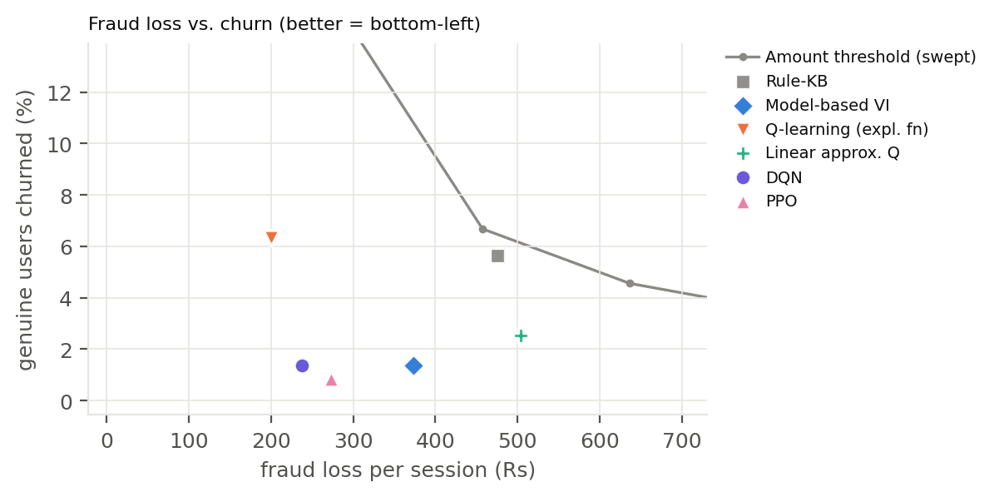
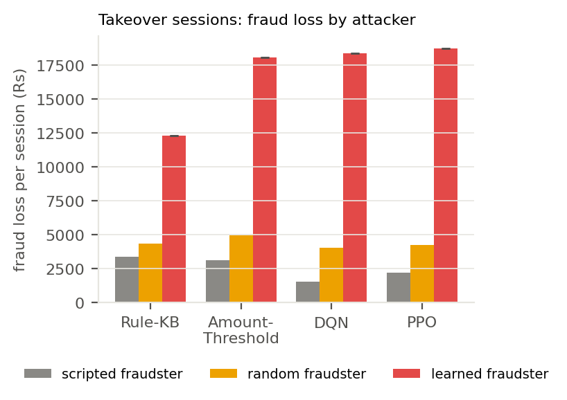

# FrictionRL: learning when to ask for an OTP

**CSL3090 Artificial Intelligence, IIT Jodhpur. Assignment 2: Real-Life Use Cases of RL.**
Team: Tanisha Ray (B24CM1061), Cherry Aggarwal (B24CM1016)

For every UPI or card payment, a bank decides to **approve** it, ask for an **OTP**, or **block** it. Fixed rules
either let a fraudster who has taken over an account empty it, or bury genuine users in OTPs until they leave the
app. FrictionRL treats each user session as a Markov Decision Process and trains reinforcement-learning agents to
balance fraud loss against friction and lost customers, measured in rupees. It is meant as an extra risk-based
layer on top of the authentication banks already require, not a replacement for it.

* **Report:** [`report/main.tex`](report/main.tex) (two-column LaTeX, 2 pages).
* **Live demo:** [`docs/index.html`](docs/index.html) runs the trained DQN in the browser on new sessions, next to the
  rule base. Open the file locally, or at <https://codertanisha22.github.io/FrictionRL/> once GitHub Pages is enabled
  for the `docs/` folder.

## Why reinforcement learning

* **Friction adds up:** every OTP makes the next one more likely to drive a genuine user away.
* **Acting early pays later:** stopping a fraudster now prevents all of their later payments.
* **Actions give information:** a failed OTP is strong evidence that the account was taken over.
* **Fraudsters adapt:** a blocked fraudster retries with a smaller amount.

A classifier scores one payment at a time; these effects only show up over a whole session.

## The MDP

An episode is one user session of up to **H = 20** payments, with discount **γ = 0.99**. With probability 0.15 a
fraudster takes over the account at a random step between 2 and 14. The agent is never told when.

**State:** 11 numbers (continuous). Tabular methods group them into 432 discrete states.

| # | Feature | # | Feature |
|---|---|---|---|
| 0 | amount vs. the user's usual (log ratio) | 6 | progress t / H |
| 1 | new device | 7 | OTPs asked so far / 3 |
| 2 | new payee | 8 | an OTP failed this session |
| 3 | odd hour | 9 | an OTP was passed |
| 4 | burst (right after the last payment) | 10 | blocks so far / 2 |
| 5 | share of risky payments so far | | |

**Actions:** APPROVE, OTP, BLOCK (discrete).

**Reward** (rupees per payment of amount x, divided by 1000 for training):

R = 0.02x [genuine paid] − (x + 200) [fraud paid] − 2 [OTP] − 50 [genuine blocked] − 3000 [user leaves] − 1500 [genuine account frozen]

There is deliberately no bonus for catching fraud, so the agent cannot gain by blocking everything.

**Dynamics** (all in [`frictionrl/config.py`](frictionrl/config.py)):

| Event | Probability |
|---|---|
| genuine user passes an OTP | 0.97 |
| genuine user leaves after an OTP | 0.01 + 0.04 × (OTPs so far) |
| genuine user leaves after a wrong block | 0.20 + 0.20 × (blocks so far) |
| fraudster beats an OTP | 0.15 |
| fraudster gives up after a failed OTP | 0.70 |
| after a block, fraudster retries at half the amount | 0.50 (otherwise gives up) |
| fraudster cashes out after each payment | 0.30 |
| second block | freezes the account (episode ends) |

## Results

Every agent is scored on **5,000 test sessions** whose seeds are never used in training or validation. Learned
agents: mean ± std over 3 training seeds; baselines and value iteration: one run.

### Synthetic data ([`results/results_table.md`](results/results_table.md))

| Agent | Net Rs / session ↑ | Fraud loss Rs ↓ | Churn % ↓ | OTPs / session |
|---|---|---|---|---|
| Always approve | −1,517 | 2,116 | 0.0 | 0.0 |
| Always OTP | −2,886 | 40 | 100.0 | 6.7 |
| Random | −2,411 | 86 | 57.2 | 1.7 |
| Amount threshold (best of 13) | −171 | 457 | 6.7 | 1.0 |
| Rule base | −155 | 475 | 5.6 | 0.5 |
| Value iteration | 178 | 373 | 1.4 | 0.4 |
| Q-learning (ε-greedy) | 200 ± 49 | 220 | 5.0 | 1.4 |
| Q-learning (exploration fn) | 159 ± 65 | 200 | 6.3 | 1.4 |
| Linear Q | 10 ± 97 | 504 | 2.5 | 1.2 |
| **DQN** | **315 ± 21** | 238 | 1.4 | 0.4 |
| **PPO** | 299 ± 30 | 273 | **0.9** | 0.5 |

* DQN and PPO earn about Rs 470 more per session than the rule base, halve fraud loss and cut churn from 5.6% to about 1%.
* Value iteration (226 sweeps) and policy iteration (5 steps) give the same policy. On an exactly Markov copy of the
  learned model, Q-learning matches it on 99.1% of decisions; on the real simulator 95.2% (the fraudster is hidden).
* Raising the customer lifetime value (Rs 1,000 / 3,000 / 8,000) lowers PPO's OTPs (0.98 / 0.49 / 0.33 per session)
  and churn (2.2 / 0.8 / 0.3%).



### Real transactions, IEEE-CIS ([`results_ieee/results_table.md`](results_ieee/results_table.md))

| Agent | Net Rs / session ↑ | Fraud loss Rs ↓ | Churn % ↓ | OTPs / session |
|---|---|---|---|---|
| Always approve | −1,182 | 7,102 | 0.0 | 0.0 |
| Amount threshold | 161 | 5,462 | 3.1 | 0.9 |
| Rule base | −198 | 6,049 | 0.7 | 0.2 |
| Value iteration | −1,054 | 6,963 | 0.3 | 0.0 |
| Q-learning (ε-greedy) | −1,233 ± 853 | 958 | 80.8 | 5.2 |
| Linear Q | −1,472 ± 98 | 6,965 | 5.5 | 1.8 |
| DQN | 88 ± 1,008 | 4,918 | 12.5 | 1.4 |
| **PPO** | **931 ± 540** | 4,395 | 8.5 | 2.1 |

Real fraud signals are much weaker (new device: 4.5% of genuine vs 12% of fraud payments, against 8% vs 65% in our
generator). PPO has the highest mean and beats every baseline on each of its 3 seeds (Rs 522, 728, 1,544), but the
**seed variance is high (± 540)**, so treat this as encouraging rather than conclusive. 83% of fraudulent payments
still go through: PPO mostly gains by tuning how often it asks for an OTP. DQN is unstable (one seed at Rs 1,245,
two below zero) and the tabular methods fail. Hyperparameters were tuned on synthetic data and not re-tuned.

### Red team: a learned fraudster ([`results_adversary/results_table.md`](results_adversary/results_table.md))

All defenders were trained against the scripted fraudster above. Here a PPO fraudster is trained against each
**frozen** defender. Per fraudulent payment it picks the amount (0.5×, 1× or 2.5× usual), **stealth** (fewer risk
flags, but it keeps 60% and the owner notices with probability 0.1), or cashing out. Fraud loss per session on
3,000 test sessions with a guaranteed takeover:

| Defender | Scripted | Random | Learned | Exploitability (learned − scripted) | Learned − random |
|---|---|---|---|---|---|
| Rule base | 3,363 | 4,318 | 12,265 | 8,902 | 7,947 |
| Amount threshold | 3,113 | 4,958 | 18,050 | 14,937 | 13,092 |
| DQN | 1,523 | 4,011 | 18,328 | 16,805 | 14,317 |
| PPO | 2,182 | 4,203 | 18,702 | 16,520 | 14,499 |

Every defender is exploitable, and the RL defenders most of all: against DQN and PPO the fraudster always uses
large stealth payments; against the threshold rule it stays at 1× to slip under it. The scripted fraudster cashes
out at random (30% per payment) while the random and learned attackers do not, so the last column shows the part
that comes from learning. Both attacker seeds learned the same strategy, so their std is 0.



## Install and run

Python 3.10 or newer (tested with 3.10); a CPU is enough.

```bash
git clone https://github.com/coderTanisha22/FrictionRL.git && cd FrictionRL
python3 -m venv .venv && source .venv/bin/activate      # Windows: .venv\Scripts\activate
pip install -r requirements.txt
python -m pytest -q                                      # 12 tests, about 5 s
```

On a machine without a GPU, `pip install torch --index-url https://download.pytorch.org/whl/cpu` first keeps the
download small.

**Demo** (uses the trained agents in `results/models/`):

```bash
python scripts/demo_session.py --agent dqn --seed 7     # also: --agent ppo, --agent rule
```

**Reproduce** (approximate times):

| Command | What it does | Time |
|---|---|---|
| `python scripts/run_all.py --quick` | every agent, 1 seed, short training | ~2 min |
| `python scripts/run_all.py` | full synthetic run (writes `results/`) | ~35–45 min on 2 cores |
| `python scripts/make_figures.py` | figures and `results_table.md` | seconds |
| `python scripts/red_team.py --quick` | red-team smoke test | ~2 min |
| `python scripts/red_team.py --workers 8` | full red team (writes `results_adversary/`) | ~6 min on 16 cores |

`run_all.py --workers N` trains N DQN/PPO jobs in parallel; `--out <folder>` writes somewhere other than `results/`.

**Real data.** The IEEE-CIS dataset is not in this repository (Kaggle's rules restrict sharing it, and the main
file is 652 MB). With a Kaggle account, accept the rules at <https://www.kaggle.com/c/ieee-fraud-detection/rules>,
save an API token in `~/.kaggle/`, then:

```bash
bash scripts/get_ieee_data.sh                                            # download, build, check (see data/README.md)
python scripts/run_all.py --source ieee --out results_ieee --workers 8   # ~20 min on 16 cores
python scripts/make_figures.py --results results_ieee
```

The tests include a fake 2,000-row file in the IEEE-CIS format, so the real-data code is tested without the download.

## Real vs simulated, and limitations

| | Synthetic run | IEEE-CIS run |
|---|---|---|
| Payment features (amount ratio, device, payee, hour, burst) | generated | **real** rows (590,540 transactions, 3.5% fraud) |
| Each user's typical amount | generated | **real** per-customer average (Rs 85 per USD) |
| Session structure and takeover timing | simulated | simulated |
| Reactions: churn, OTP pass rates, fraudster retries | assumed | assumed |

* No public dataset records how people react to an OTP or a block, so all reaction probabilities are our
  assumptions; the lifetime-value study shows how the policy shifts when costs change.
* The state hides the fraudster, so strictly the problem is a POMDP; history features make it close to Markov.
* The red-team attack model is ours and not calibrated on data. Next step: train defender and fraudster in turn.

## Repository layout

```
frictionrl/
  config.py      all constants (MDP, behaviour, rupee costs)
  simulator.py   payment sources: synthetic generator, IEEE-CIS replay
  env.py         FrictionEnv (Gymnasium); optional red-team attacker hook
  baselines.py   non-learning baselines and the rule base
  planning.py    model-based learning, value iteration, policy iteration
  qlearning.py   tabular and linear approximate Q-learning
  train_sb3.py   DQN and PPO
  evaluate.py    test sessions and metrics
  data_ieee.py   IEEE-CIS feature builder
  attacker.py    red team: attack actions and FraudsterEnv
scripts/         run_all.py, make_figures.py, demo_session.py, red_team.py, check_ieee.py, get_ieee_data.sh
tests/           test_env.py (12 tests)
results/         synthetic results, trained models, figures
results_ieee/    real-data results, trained models, figures
results_adversary/  red-team results, trained fraudsters, figures
docs/            live demo page
report/          LaTeX report
data/README.md   how to get the real data
```

## References

* L. Zintgraf, E. Lopez-Rojas, D. Roijers, A. Nowé. MultiMAuS: a multi-modal authentication simulator for fraud
  detection research. EMSS, 2017.
* Vimal et al., 2021. TODO: full reference.
* D. Lunghi et al. FRAUD-RLA: a new reinforcement learning adversarial attack against credit card fraud detection.
  arXiv:2502.02290, 2025.
* A. Raffin et al. Stable-Baselines3: reliable reinforcement learning implementations. JMLR, 2021.
* S. Russell, P. Norvig. Artificial Intelligence: A Modern Approach, 4th ed., 2021.
* IEEE-CIS Fraud Detection, Kaggle, 2019.
